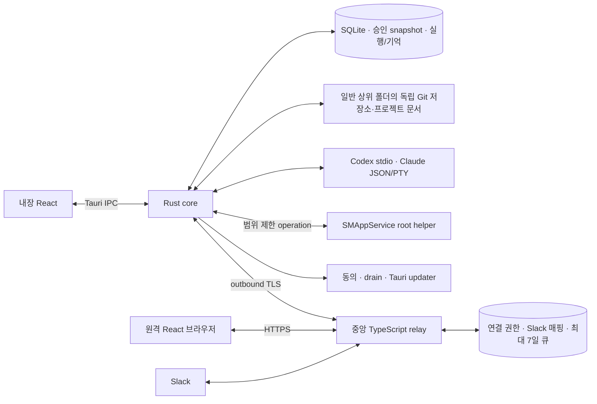

# 구현 구조와 데이터 경계

기준: 2026-09-19. Rust 모듈별 이식·Tauri + React는 D-036의 선택이다. Python은 참조 구현으로 보존하며 기존 DB/세션/모든 이력의 자동 이전은 범위에 추가하지 않는다. 아래 라이브러리·내부 모듈·DTO는 구현 설계이고 제품 실험 통과를 뜻하지 않는다.

## 로컬 실행과 같은 React 콘솔

Mac의 일반 사용자 Rust core가 실행·SQLite·승인·기억·예산을 소유한다. 빌드한 React를 Tauri에 번들하고 같은 UI를 중앙 HTTPS에서 제공한다. 내장 창은 IPC, 원격 브라우저는 HTTPS/실시간 어댑터를 사용한다. 로컬 앱 시작에 Node/Vite/Python 상주 서버가 필요하지 않으며 중앙 장애에도 내장 화면을 사용할 수 있다.

중앙 기본안은 TypeScript/Node·Fastify/WebSocket·Slack Bolt·PostgreSQL이다. 사내 EC2 단일 VM에서 시작하고 큐의 정본을 메모리에 두지 않는다. 초기 Redis·별도 분산 워크플로·다중 리전 도입은 요구가 아니다. 서버가 멈추면 원격/Slack 수신이 중단되므로 Mac 오프라인 7일 큐와 서버 장애 중 무손실 수신을 같은 보장으로 표시하지 않는다.

Rust 후보는 tokio·serde·rusqlite·portable-pty와 터미널 상태 어댑터다. SQLite는 단일 writer와 명시적 migration을 둔다. Git/gh는 검증된 실행파일을 호출하며 필요한 설치는 Q-008을 따른다. 정확한 crate/npm/CLI 버전·라이선스·OS 조합은 실제 배포물/lockfile과 검증으로 고정한다. Tauri updater 2.10.1은 2026-09-18 조사 후보이며 설치/호환 완료값이 아니다.

중앙 UI는 정적 React SPA다. 브라우저의 상호작용·렌더링은 접속 장치에서 실행되므로 중앙 호스팅이 Mac의 UI 자원 사용을 없애지는 않는다. 시스템 WebView·CLI·브라우저를 포함한 시나리오로 CPU/RAM/반응성/배터리를 측정한다. 사내 개발자·비개발자 대상이며 제품 계정·결제·홍보 사이트는 범위 밖이다.

## 구성요소의 책임

| 구성요소 | 소유하는 책임 | 상세 계약 |
| --- | --- | --- |
| Domain/Store | 프로젝트/저장소 집합, 요청, 불변 명세/승인, 트랜잭션, 이벤트/inbox/outbox | [데이터 계약](specs/data-contracts.md) |
| Assessment/Research | 맥락/위험 평가, 근거·인터뷰·세 묶음 승인 자료 | [흐름](specs/workflow.md) |
| SOT/Planner/Intent check | 간결한 정본·작은 작업·구체 지시·실행 전 의도 대조 | [오케스트레이션](specs/orchestration.md) |
| Scheduler/Policy | 의존성·자원/계정/예산 lease, 위임, 실행 전제 | [실행](specs/orchestration.md#scheduler) |
| CLI drivers | 공식 CLI의 인증/모델/질문/권한/중단/재개 의미 계약 | [계정/비용](specs/accounts-and-budget.md) |
| Repository coordinator | 도구·Git 정책·작성자·독립 저장소·문서·결과 반영 | [저장소](specs/repositories.md) |
| Verification | 실제 기준별 증거·위험 리뷰·기존 실패·자동 완료 | [검수](specs/orchestration.md#verification) |
| Memory/Recovery | 기억과 적용 시점·체크포인트·재개·취소·프로젝트 수명 | [기억/수명](specs/memory-and-lifecycle.md) |
| Resource manager | 생성 시 소유권/consumer, 산출물 승격, 삭제·실패/재시도 | [자원](specs/resources.md) |
| Update coordinator/Helper | 버전 동의·서명·drain·복구·한정 관리자 operation | [설치/업데이트](specs/install-and-update.md) |
| Tauri/React/Relay client | 설치/트레이/IPC, 공통 화면과 채널 어댑터 | [원격/Slack](specs/remote-and-slack.md) |
| 중앙 Relay | 장치/브라우저 인증, 온라인 화면 중계, Slack OAuth·영속 전달 | [원격/Slack](specs/remote-and-slack.md) |

UI 없이 core/driver/복구를 검증할 수 있게 한다. 일반 UI/core/CLI, GUI 화면 제어 프로세스, root helper는 서로 다른 권한 경계다. 원격 payload나 AI 문자열을 검증 없이 OS/root shell로 실행하지 않는다. 공급자 내부 수행은 자율이지만 앱 작업의 경계·의도·결과 책임은 core에 있다.

## 정본과 저장 위치

| 데이터 | 기준 위치 | 원격/중앙 허용 범위 |
| --- | --- | --- |
| 프로젝트 코드·정리된 요구/기능/결정·와이어프레임/API/디자인·최종 자산 | 로컬 독립 Git 저장소. 공통/저장소별 문서 원본은 하나 | 해당 프로젝트가 허용한 Git 원격 저장. 중앙은 요청한 화면 범위만 일시 중계 |
| 승인 snapshot·위임·예산·작업/복구 상태·앱 기억 | Mac 앱 SQLite·불변 저장소 | Git 자동 업로드 제외. 중앙 프로젝트 이력 DB/캐시로 복제하지 않음 |
| AI 인증·공식 CLI 프로필/세션 | Mac 공식 저장소·OS credential | 중앙 업로드·구독 프록시 없음 |
| 장치/브라우저 권한·취소 | 로컬/중앙 연결 레지스트리 | 원격 인증에 필요한 최소 메타데이터 |
| Slack 설치 token·workspace/channel/thread 매핑 | 중앙 암호화 연결 저장소, 로컬 요청 연결 | 필요한 OAuth/알림/라우팅, 해제 시 무효화·정리 |
| 미전달 Slack 요청/답변·일시 첨부 | 중앙 영속 암호화 큐 | 최초 수신부터 최대 7일, 로컬 영속 수락/만료/취소 후 본문 삭제 |
| command ID·receipt·적용/만료 상태 | 로컬/중앙 최소 전송 원장 | 본문 없이 중복/복구 판단에 필요한 기간. 최소 전달 창+시계 오차 검증 |

Git 작업본과 승인 snapshot은 같은 문서 ID/revision/hash로 연결하며 별도 독립 정본으로 갱신하지 않는다. clone이나 Git commit만으로 이 Mac의 승인·계정·위임을 복원하지 않는다. 공식 프로젝트 파일은 앱이 만들었어도 임시물로 삭제하지 않는다.

TLS와 저장 암호화를 사용하되 중앙이 본문을 처리하므로 E2EE를 보장하지 않는다. 비밀·암호화 키는 일반 DB/log와 분리하고 회전/폐기/복원 검증을 한다. 온라인 응답은 no-store, 프로젝트 Service Worker 캐시는 두지 않는다. 이미 본 화면의 사용자 캡처까지 회수할 수 있다고 하지 않는다.

구현 순서는 [roadmap.md](roadmap.md), 현재 Python 대비 차이는 [implementation-gap.csv](implementation-gap.csv), 실험 조건은 [verification.csv](verification.csv)를 따른다.
