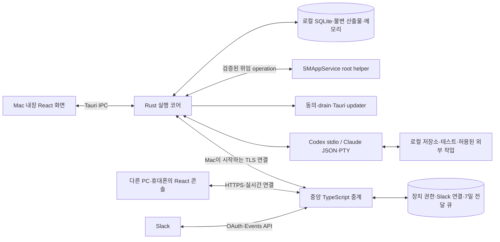
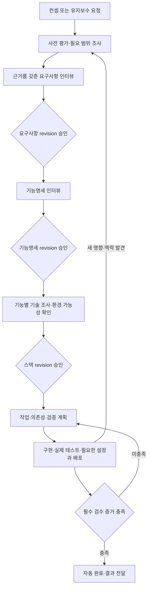

# 목표 구조와 구현 순서

> 보존 기록: 아래는 통합 전 원문/당시 판단이다. 현재 구현 기준은 [정본 안내](../../README.md)와 decisions.csv의 후속 관계를 따른다.

기준일: 2026-09-17. 최종 반영일: 2026-09-18. [원래 흐름](../../00-original-flow.md), [기능별 격차](01-implementation-gap.md), [추가 결정](02-product-decisions.md), [후속 세부 결정 D-039~066](04-resolved-details.md)을 구현으로 연결한다. 이번 세션은 이 설계 문서만 수정하며 제품 코드는 구현하지 않는다. 이 문서의 구성요소·계약은 목표 설계이며 현재 구현됐다는 뜻이 아니다. 사용자가 선택한 Rust 모듈별 이식과 Tauri + React를 기본으로, 세부 도구는 검증 결과에 따라 조정한다.

## 1. 권장 구조

**Mac의 Rust 코어가 실행·상태·메모리를 소유하고, 같은 React 화면을 Tauri 내장 창과 중앙 웹에서 제공한다.** 중앙 서버는 정적 UI, 장치 연결, 화면 데이터·명령 중계, 선택형 Slack OAuth·전달 큐를 담당한다. 로컬의 React 개발 서버나 웹 API 서버는 제품 실행에 필요하지 않다.

React를 중앙에서 제공하거나 HTML을 서버에서 렌더링하더라도 브라우저의 상호작용·상태 갱신·화면 그리기는 접속 장치에서 일어난다. 따라서 ‘서버 렌더링이면 Mac의 UI 메모리 사용이 사라진다’는 전제로 결정하지 않는다. 이 제품은 사내 소규모 사용 도구이며 **콘솔은 정적 React SPA**로 제공한다. 제품 홍보·결제 사이트는 만들지 않는다(D-035/D-051). 이는 React·Tauri 공식 설명에 근거한 설계 판단이다(RES-010/011).

내장 UI는 빌드된 HTML/CSS/JS를 Tauri에 포함하고 Rust 호출·이벤트를 IPC로 연결한다. 중앙 UI도 같은 화면 패키지를 사용하되 HTTPS·실시간 전송 어댑터로 연결한다. 브라우저 UI를 열지 않으면 그 장치의 UI 렌더링 비용은 발생하지 않지만, 로컬 코어와 CLI 비용은 계속 존재한다. 실제 풋프린트는 V-07에서 측정한다.

| 후보 | 장점·비용 | 판단 |
| --- | --- | --- |
| Python 유지 + 정적 React | 기존 로직을 빨리 재사용. 패키저가 Python 런타임을 포함할 수 있으므로 사용자 Python 설치가 반드시 필요한 것은 아님. 다만 배포 런타임·드라이버·앱 수명 관리가 남음. | 기술적으로 가능한 대안. 사용자가 Rust 이식을 선택했으므로 참조 구현으로 보존. |
| Rust + Tauri + React, 중앙 TypeScript | 로컬 실행·저장·프로세스 수명과 UI 경계를 명확히 분리. Tauri는 시스템 WebView 사용. 같은 화면·계약을 내장/원격에서 공유 가능. | 채택 방향. Rust PTY 판정 재현·패키징·권한 실험이 필요. 작은 설치 용량이나 낮은 RAM을 미리 보장하지 않음. |
| 중앙 콘솔만 제공 | 로컬 UI 번들은 줄일 수 있음. 중앙 장애·네트워크 단절 때 조작이 제한됨. | D-028의 내장 콘솔 요구를 충족하지 않아 채택하지 않음. |
| 중앙에서 에이전트까지 실행 | Mac 오프라인 실행은 가능해질 수 있으나 저장소·자격 증명·환경·비용 구조가 달라짐. | 로컬 실행·정본이라는 요구와 범위가 달라 이번 설계에 포함하지 않음. |

중앙 기본안은 TypeScript + Node.js, Fastify와 WebSocket 플러그인, Slack Bolt, PostgreSQL이다. 사용자가 배포 단계에 제공할 EC2 VM 하나에서 시작하되 큐의 진실을 프로세스 메모리에 두지 않는다. 초기에는 Redis·별도 분산 워크플로 서버 없이 PostgreSQL의 영속 큐·트랜잭션을 사용한다. 고가용성이나 다중 리전은 확정 요구가 아니며, 단일 서버가 멈추면 원격·Slack 수신이 중단되는 운영 한계를 O-04에서 다룬다.

Rust 후보는 `tokio`, `serde`, `rusqlite`, `portable-pty`, 터미널 상태 판정 어댑터다. SQLite는 단일 쓰기 주체와 명시적 스키마 마이그레이션을 둔다. Git은 사용자 credential helper·설정과 맞물리므로 우선 기존 Git 실행 파일을 호출한다. 크레이트·npm 패키지의 정확한 버전, 라이선스·의존성, 지원 OS는 V-07에서 잠금 파일·배포물 기준으로 확인한다. [rewrite](../../../rewrite/03-stack-decision.md)의 후보 버전·용량 예상치를 그대로 확정하지 않는다.

## 2. 구성요소와 데이터 경계

| 구성요소 | 책임 | 하지 않는 역할 |
| --- | --- | --- |
| 로컬 Core | 작업 전 평가, 단계 승인, 영속 작업 상태, 메모리·예산·계정 프로필, 의존성·위임 검사, 검증·복구 | 원격 화면의 임의 명령을 검증 없이 OS 명령으로 실행하지 않음. |
| CLI Driver | 공식 CLI 시작·인증 상태 확인·모델/강도 검증·질문·승인·중단·재개·관측 | 제품 승인, 예산, 메모리 정책의 정본이 아님. |
| Privileged Helper | 서명된 호출자·task 위임을 검증한 한정 관리자 작업과 receipt | 임의 root shell·화면 조작·SIP/TCC 우회 역할이 아님. |
| Resource Manager | 앱 소유 자원·소비자·보존 이유·삭제 결과·재시도 | 사용자 원본·활성 자원·필수 증거를 임의 정리하지 않음. |
| Update Coordinator | 버전별 동의·download/install 분리·drain·helper/DB 호환 검사 | UI의 직접 설치 호출로 동의·작업 정리를 우회하지 않음. |
| Tauri Shell | 설치·트레이·로컬 창·OS 권한·업데이트·IPC | 중앙에서 다운로드한 임의 페이지에 광범위한 네이티브 권한을 주지 않음. |
| React UI | 프로젝트/요청, 질문·승인, 기억, 계정·예산, 증거·대기 사유 표시 | UI 메모리나 브라우저 저장소가 실행 정본이 아님. |
| 중앙 Relay | 장치·브라우저 인증, 온라인 조회 중계, Slack OAuth·이벤트 수신·내구성 있는 전달 | 프로젝트 분석·AI 실행·프로젝트 정본 저장을 맡지 않음. |

로컬 모듈은 `domain`, `store`, `assessment`, `memory`, `research`, `scheduler`, `policy`, `drivers`, `verification`, `relay-client`, `resources`, `update-coordinator`, `privileged-client`로 나누는 안을 사용한다. UI가 없어도 코어·드라이버·복구 테스트를 실행할 수 있게 한다. 정본 코어는 일반 사용자 프로세스에 두고 CLI 자식·GUI 화면 조작·번들 root helper는 별도 권한 경계로 관리하며 ‘모든 실행이 단일 바이너리 하나’라고 표현하지 않는다.

| 데이터 | 정본·보존 위치 | 중앙 허용 범위 |
| --- | --- | --- |
| 저장소·요구/기능 CSV·스택·승인 snapshot·실행 증거·기억 | Mac 로컬 | 연결된 콘솔이 요청한 표시 범위를 일시 중계. 중앙 프로젝트 이력 DB나 영구 캐시로 복제하지 않음. |
| 온라인 프로젝트 목록·진행·질문 화면 | Mac 로컬 | 연결 중 최소 화면 모델 중계. HTTP 캐시·분석 로그에 프로젝트 본문을 남기지 않음. |
| AI 인증·프로필 디렉터리·CLI 내부 세션 | Mac의 공식 CLI 저장소·OS 자격 증명 저장소 | 업로드하지 않음. Relay에서 사용자의 AI 구독 요청을 대신 실행하지 않음. |
| 장치 공개 식별자·권한·브라우저 연결·취소 상태 | 로컬과 중앙의 연결 레지스트리 | 원격 인증에 필요한 메타데이터 보존. 표시 별칭에도 불필요한 프로젝트 정보를 넣지 않음. |
| Slack 설치 토큰·workspace/channel/thread 매핑 | 중앙의 암호화된 연결 저장소, 로컬 요청 연결 | OAuth·알림·답변 라우팅에 필요한 범위만 저장. 연결 해제 시 무효화·정리. |
| Mac 미전달 Slack 요청·답변 본문 | 중앙 영속 큐 | 최대 7일, 전달 수락 확인 또는 만료 때 본문 삭제. 장기 백업·오류 로그로 보존 기간을 우회하지 않음. |
| 명령 ID·receipt·만료/적용 상태 | 로컬 및 중앙의 최소 전송 원장 | 본문 없이 재전달·중복 판정에 필요한 기간 보존. 최소 7일 전달 창과 시계 오차를 포함하는 정책을 V-05에서 검증. |

TLS와 저장 시 암호화를 기본으로 하되 **종단간 암호화를 구현했다고 주장하지 않는다.** 이 기본 구조에서는 Slack 및 중계 처리 과정에서 중앙이 본문을 처리할 수 있다. 암호화 키·OAuth 비밀은 애플리케이션 DB/로그와 분리해 관리하며 키 회전·폐기·백업 복구 실험을 포함한다. 사용자 데이터의 AI 공급자·Slack 전송과 중앙 보관 범위는 연결 화면에서 구체적으로 설명한다.

원격 상세 응답은 `no-store`로 제공하고 프로젝트 데이터의 Service Worker/offline cache를 두지 않는다. 연결이 끊기면 UI는 오프라인 표시로 전환하고 상세 메모리 상태를 정리한다. 정적 UI 파일 캐시와 프로젝트 내용 캐시는 구분한다. 브라우저 화면을 이미 본 사람의 캡처까지 회수할 수 있다는 약속은 하지 않는다.

## 3. 공통 도메인 계약

아래는 구현 전에 고정할 최소 의미 계약이다. 실제 직렬화 스키마는 버전 관리하고 Rust/TypeScript 양쪽의 fixture로 호환성을 검사한다. 파일 경로·내부 모델의 모든 필드를 UI에 직접 노출하지 않는다.

| 계약 | 필수 정보·불변 조건 |
| --- | --- |
| Project / WorkRequest | `project_id`, 실제 저장소 식별, `request_id`, 신규/유지보수 목적, 유지할 동작, 요청 상태. 같은 프로젝트에 여러 요청이 있어도 기억은 프로젝트에 연결. |
| Assessment | 요청·입력 revision, 실제 모델/강도, 읽은 범위, 부족한 맥락, 국소/확장/전체 검토 이유, 영향 FEAT, 재사용 승인, 의존성·환경 요구, 재평가 조건. |
| SpecRevision / Approval | 문서 종류, 불변 내용 hash·저장 참조, 부모 revision, REQ/FEAT 연결, 승인자/채널/시각, 적용 범위·전제. 승인 번호만 있고 본문이 바뀌는 구조 금지. |
| ResearchTopic | 결정할 문제, 조사 시각, 출처·확인 사실·해석·대안·제약·미확인점, 공급자별 결과, 갱신 조건. 교차 조사하지 않은 결과를 교차 확인으로 표시하지 않음. |
| MemoryItem / ContextBundle | 범위·종류·출처·검증 증거·revision·삭제 표식. 번들은 참조한 정확한 명세·기억·정책 버전, 적용 조건과 누락 범위를 포함. |
| TaskContract | 요청/FEAT/승인 참조, 선행 작업, `read_set`, `write_set`, 외부 효과 범위, 입력 hash, 기억·위임·예산 revision, 검증 계획, 예상 복구 방식, 실행 attempt·lease 세대. |
| AccountProfile / RoleRoute | 공급자·별칭·로컬 설정 위치, 확인된 계정 정체성, CLI 버전, 모델/강도 능력과 관측 시각, 과금 유형·허용 경로. 인증 비밀은 DTO에 포함하지 않음. |
| Delegation / BudgetReservation | 프로젝트·환경·자원·허용 행동·비용·유효 조건, 정책 revision. 예약 통화·기간·상한/추정·정산 상태, 공급자 사용 증거. |
| Question / Command | `command_id`, 장치/프로젝트/요청, 질문 종류와 `question_id`, 대상 revision, 기대 상태 버전, 발신 채널·권한, 생성/만료 시각, payload schema. |
| Receipt / DomainEvent | 명령 ID, `received / accepted / applied / rejected / expired` 및 이유, 로컬 이벤트 순번. 실행 완료는 별도 작업 결과이며 수신 확인과 혼동하지 않음. |
| VerificationEvidence / SideEffect | FEAT·검수기준·입력/산출물 hash·환경·명령·실제 결과·시각·제약. 외부 효과는 의도·idempotency key·외부 receipt·상태 조회·불명확 여부를 보존. |

추가 계약은 [세부 문서](04-resolved-details.md)의 정의를 함께 사용한다.

| 계약 | 필수 정보·불변 조건 |
| --- | --- |
| DriverCapabilities / SessionEvent | CLI 버전·인증 유형·모델/effort·질문/권한/cancel/resume 능력, session/turn/attempt ID와 정규화 이벤트. 미지원 입력을 조용히 축소하지 않음. |
| ExperimentContract | 승인 전 격리 실험의 목적·성공 조건·입출력/쓰기 범위·예산·권한·정리 조건. 제품 구현 권한과 분리. |
| SourceRevision / Attachment | Slack 원본 식별·편집 세대·불변 command ID, 첨부 출처·hash·확보 상태·consumer·정리 상태. |
| PrivilegedOperation | task/attempt·호출자·위임 revision·허용 대상/행동·유효 조건·idempotency/receipt/복구. root는 명시 범위만 실행. |
| ManagedResource | 앱 소유 root·resource/owner ID·consumer/lease·retain reason·결과 승격·삭제 상태/실패/재시도. 마지막 참조 후 확인된 삭제. |
| UpdateState / Compatibility | 동의한 릴리스 식별, download/verify/drain/install/restart/health 단계, app/helper/protocol/schema 범위. 비호환 DB에 실행 파일만 롤백하지 않음. |

`상태`는 세 가지를 분리한다. CSV의 **기획 결정 상태**, 실행기의 **작업 상태**, 채널의 **전달 상태**다. UI에서 ‘확정’, ‘완료’, ‘전달됨’을 같은 색상·단어로 뭉개지 않는다.

## 4. 단계 흐름·명세 변경

유지보수 요청은 유효한 기존 승인·조사를 재사용하되 평가 결과와 재사용 이유를 남긴다. 의미가 바뀐 범위만 새 revision과 필요한 승인으로 연결한다. 작업 진행 도중 새 판단이 발견되면 관련 작업만 보류하고 무관한 독립 작업은 계속할 수 있다.

CSV 파일은 사용자가 직접 편집할 수 있는 작업본이다. 승인 시 불변 snapshot과 hash를 저장한다. 명세 검증은 새 11열 요구사항·15열 기능 스키마 및 안정적인 ID·참조를 따른다. 실행 상태·작업 산출물은 별도 DB 모델로 관리하여 CSV의 `확정/초안/기술검증필요` 의미를 훼손하지 않는다. 기존 18열 스키마 입력을 새 스키마라고 조용히 받아들이지 않는다.

외부 편집과 대화 편집은 같은 변경 명령으로 처리한다. 파일 변경을 감지하면 마지막 적용 revision과 비교하고, 파싱 실패·참조 누락·동시 변경·정책 충돌을 검토한다. 저장 도중의 부분 파일은 안정화 후 읽고 이전 유효 snapshot을 유지한다. 충돌 해결은 근거·영향·구체 diff를 설명한 후 사용자의 적용 확인을 받는다. 오래된 화면에서 보낸 승인에는 `expected_revision` 불일치 결과를 돌려주고 최신 변경분을 보여준다.

새 명세가 확정되면 의존 작업의 입력 hash·승인·검증 증거 유효성을 다시 계산한다. 바뀐 기능을 기존 `tested` 표식만으로 완료 처리하지 않는다. 최종 완료는 승인된 요청의 필수 검수기준을 실제로 통과하고 필요한 설치·배포·실사용 확인이 끝났을 때 자동으로 발생한다. 사람에게만 가능한 인증·실기기 확인이 남으면 구체적으로 인계하고, 미완료 상태를 유지한다.

## 5. 실행·계정·메모리·복구

### 실행 스케줄러

작업 상태는 `planned → ready → running → verifying → completed`를 기본으로 하며 `waiting_user`, `blocked`, `interrupting`, `interrupted`, `failed`, `recovery_required`, `cancelled`를 명시한다. 전이는 DB 트랜잭션 안에서 기록하고 이벤트 outbox를 함께 쓴다. UI 연결이나 프로세스 메모리가 상태 전이의 유일한 근거가 되어서는 안 된다.

실행 전에는 선행 작업·세 승인·ContextBundle·위임·예산·계정 능력·자원 lease를 검사한다. 실제 저장소 경로를 정규화하고 동일 저장소·symlink·공통 DB·포트·배포 대상 등 논리 자원을 같은 ID로 취급한다. read/write 충돌식은 D-032를 따른다. 문서·설정·스키마·생성 파일·기억의 적용 revision도 입력으로 추적한다.

가능한 한 격리된 작업 디렉터리에서 작업하고 변경 묶음을 검증한 뒤 적용한다. 그러나 격리된 worktree가 의미적 의존성을 지우지는 않는다. CLI가 저장소 전체를 자유롭게 읽는 경우 `read_set`을 일부 파일이라고 축소해서 신고하지 않는다. 실제 접근을 제한하거나 관찰·중단할 수 없는 구간은 해당 저장소 전체에 보수적인 잠금을 잡는다. 병렬성보다 D-032의 일관성 요구가 우선이다.

잠금·예산·계정 슬롯은 일관된 순서 또는 한 예약 트랜잭션으로 획득해 교착을 피한다. 준비된 독립 작업은 기본적으로 오래 기다린 순서로 실행하고 사용자가 우선순위를 조정할 수 있게 하는 안을 사용한다. 자원 한도는 설정 가능하게 하며 초기 슬롯 1개에서 검증한다. foreground 작업은 별도 독점 예약과 합의된 시간 범위를 요구한다.

### 드라이버·프로필·역할

Codex는 기존 구조화 app-server stdio 계약을 우선한다. 실험적 원격 app-server 전송을 제품 중계 프로토콜로 그대로 노출하지 않는다. Claude는 공식 CLI stream-json을 우선하고 대화형 전용 기능은 PTY로 보완한다(D-056). 구독 인증·설정 로딩·질문·권한·중단·재개를 경로별로 검증한다. 구독 경로에 --bare를 쓰거나 API 인증으로 조용히 전환하지 않는다. PTY 화면 판정·로그 회전·맥락 재구성도 검증한다. 두 공급자 모두 단독으로 전체 제품 흐름을 시작할 수 있어야 한다.

프로필마다 CLI 자식 프로세스의 설정 디렉터리를 명시하고 불필요한 상속 인증 환경을 제거한다. 이후 선택한 프로필의 `CODEX_HOME` 또는 `CLAUDE_CONFIG_DIR`를 명시적으로 주입한다. 전역 셸 설정이나 사용자의 기존 로그인 파일을 일괄 덮어쓰지 않는다. 디렉터리 이름이 다르다는 것만으로 Keychain·자격 증명 격리가 됐다고 판정하지 않고 실제 계정 관측으로 확인한다.

역할 요청에는 필요한 품질·모델·강도·허용 계정·예산·맥락 참조를 넣는다. 라우터는 확인된 능력으로 실제 경로를 고르고 선택 사유를 기록한다. 한도·인증·정책·과부하·전송 실패를 구분해 허용된 대체 경로만 사용한다. 다른 모델로 전환할 때도 제품 공통 맥락과 작업의 유효 정책을 재구성한다. 잘못된 인증·정책상 거절을 공급자 순환으로 우회하지 않는다.

구독 로그인은 공식 CLI 로그인 절차를 이용한다. 중앙 서버가 Claude.ai 세션 토큰을 수집하거나 사용자의 구독 요청을 별도 프록시로 실행하는 구조는 채택하지 않는다. 공식 CLI를 다른 제품에서 사용한다고 모든 배포 조건이 자동 충족되는 것은 아니므로 출시 버전에서 공급자 조건을 다시 확인한다(RES-013).

### 영속 기억과 재개

기억 원문과 요약·색인은 분리한다. 첫 구현은 로컬 SQLite의 구조화 필터·전문 검색과 원문 참조로 시작하고, 검색 품질 평가가 요구하면 임베딩을 추가한다. 임베딩을 전제로 불필요한 외부 전송·비용을 먼저 도입하지 않는다. 삭제·수정은 새 조회 결과와 색인에 반영하며 실행 중 적용은 D-031을 따른다. 새 CLI 세션에 AI 자동 축적 내용을 반영하면 해당 세션의 ContextBundle revision을 새로 기록한다. 사용자가 ‘다음 작업부터’로 유예한 직접 변경이나 기존 작업의 승인·위임 정책은 이 갱신으로 덮어쓰지 않는다.

체크포인트에는 작업 상태뿐 아니라 입력·승인·기억·위임 버전, 계정/모델, 비용 예약, CLI 세션 참조, 완료된 검증, 미확정 외부 효과, 대기 질문, 전달 outbox 위치를 남긴다. CLI 내부 세션을 복구할 수 없으면 이 근거로 새 세션을 구성한다. ‘같은 세션 재개’와 ‘새 세션으로 작업 재개’를 사용자에게 구분해 표시한다.

재시작 시 단순히 모든 `running` 작업을 다시 실행하지 않는다. 기존 프로세스 생존·lease 세대·파일 상태·외부 receipt를 확인하고, 같은 자원에 두 실행자가 생기지 않도록 이전 실행을 정리한 뒤 새 attempt를 발급한다. lease 만료만으로 외부 자식 프로세스가 멈췄다고 가정하지 않는다.

외부 작업은 실행 전에 의도와 고정 idempotency key를 기록하고, 지원되는 API에는 그 키를 전달한다. 성공 후 receipt를 잃었으면 상태 조회로 성공 여부를 확인한다. 조회·멱등 API가 없고 결과가 불명확하면 `recovery_required`로 남기고 구체적인 확인을 요청한다. 메시지의 멱등 적용이 외부 배포·결제·계정 생성의 ‘정확히 한 번’을 보장하지 않는다(RES-016).

## 6. 중앙 콘솔·Slack 전송

### 연결과 권한

Mac은 중앙으로 outbound TLS 연결을 시작한다. 사용자 라우터의 inbound 포트 개방을 요구하지 않는다. 장치 키와 연결 권한은 로컬에서 생성·보관하고 중앙에는 검증에 필요한 공개 정보만 등록하는 안을 사용한다. 브라우저는 짧게 유효한 일회용 코드/QR을 제시하고 Mac에서 연결 대상·조회/제어 범위를 확인받는다. 코드 추측 방지, 재사용 차단, 연결별 폐기·만료를 구현한다.

제품 계정이 없다는 이유로 인증을 생략하지 않는다. 브라우저 세션은 TLS·보안 쿠키·Origin/CSRF 검증과 장치/프로젝트 권한을 사용한다. Tauri IPC는 번들된 UI에 필요한 명령만 노출한다. 원격 페이지가 로컬 CLI 실행·파일 접근 API를 직접 호출하도록 광범위한 capability를 열지 않는다(RES-011).

일반 콘솔 명령도 안정적인 ID·기대 revision을 사용한다. Mac 연결이 없을 때 새 변경 명령은 오프라인 오류로 응답한다. 연결 중 전송하다가 끊긴 명령은 결과 불명 상태로 표시하고 동일 ID로 수락 여부를 조회한다. 브라우저가 ‘실패’라는 이유로 새로운 ID를 만들어 중복 승인·실행을 일으키지 않는다. 일반 콘솔을 장기 오프라인 작업 접수함으로 확장하지 않는다.

실시간 이벤트는 로컬의 증가하는 순번과 snapshot revision을 가진다. 재연결 시 마지막 수신 순번 이후 이벤트를 요청하고, 보존 범위를 벗어나면 최신 snapshot을 받는다. 서버는 내용을 영구 이벤트 이력으로 축적하지 않는다. 브라우저가 명령 결과를 받지 못해도 로컬 내장 콘솔에서 현재 상태를 확인할 수 있다.

인터넷 HTTPS·등록한 브라우저만 접근하며 VPN은 필수가 아니다. app/protocol/schema capability 협상으로 구버전 명령 호환을 확인한다.

### Slack 연결과 7일 큐

사내 배포의 중앙 Events API + OAuth를 기본안으로 삼는다. 공개 Marketplace 등록을 제품 범위로 요구하지 않는다(RES-014/D-051). 본인 Slack 계정만 Mac에서 연결 확인하며 DM을 기본으로 프로젝트별 지정 채널을 선택할 수 있다(D-043/D-061). Slack 설치는 임의 workspace와 로컬 Mac이 뒤섞이지 않도록 일회용 연결 state와 로컬 확인으로 묶는다. 메시지·thread를 읽고 답하는 데 필요한 최소 scopes를 실제 동작으로 검증한 후 확정한다.

| 단계 | 처리 계약 |
| --- | --- |
| 1. 수신 | Slack 서명·시각·연결 권한을 확인하고 `event_id` 등을 고유 키로 정규화한다. 이벤트/API 종류별 고유 키를 구분한다. |
| 2. 영속 수락 | `command_id`, 최초 수신 시각, 대상, 암호화 본문, `expires_at = 최초 수신 + 7일`을 트랜잭션으로 저장한 뒤 Slack에 신속히 ACK한다. 중복 수신으로 만료 시각을 연장하지 않는다. |
| 3. 대기 안내 | Mac이 오프라인이면 요청 스레드에 전달 대기와 만료 시점을 알린다. 안내 전송 자체도 outbox로 기록하고 중복 안내를 방지한다. |
| 4. 전달 | Mac 연결 중에는 즉시 시도한다. 실패하면 지수 backoff·jitter·최대 간격과 Slack의 Retry-After를 반영한다. 재연결 때 만료되지 않은 항목을 다시 시도한다. |
| 5. 로컬 수락 | 장치/프로젝트 권한·대상 revision·명령 ID를 확인한다. inbox와 명령 수락 결과를 영속 기록한 뒤 중앙에 receipt를 돌려준다. 같은 ID 재전달에는 저장된 결과를 반환한다. |
| 6. 적용·결과 | 로컬 트랜잭션에서 첫 유효 명령만 적용하고 이벤트/outbox를 함께 기록한다. 중앙 수신·로컬 수락·실제 적용·작업 완료를 구분해 콘솔과 Slack에 반영한다. |
| 7. 삭제·만료 | 로컬 영속 수락 receipt를 중앙이 기록하면 본문을 삭제한다. 전달 기한이 지나면 본문을 삭제하고 최소 만료 메타데이터·만료 통지 outbox만 남긴다. 만료 통지에도 원문을 복제하지 않는다. |

Slack Events API의 재시도 자체는 이 7일 보관·재전달을 제공하지 않는다. 앱이 내구성 있게 저장하지 못하면 성공 ACK를 보내지 않는다. Slack의 한정된 재시도 기간보다 중앙 장애가 길면 이벤트를 받을 수 없는 구간이 생길 수 있으므로 **Mac 오프라인 7일 보관과 중앙 서버 장애 중 무손실 수신을 같은 보장으로 표현하지 않는다.** 서버 장애 감지·복구 운영값은 EC2 배포 단계에 검증한다. 큐 본문은 장기 DB snapshot/PITR로 보존 제한을 우회하지 않게 분리한다.

ACK 손실이면 같은 ID로 다시 보내므로 로컬 중복 기록은 전달 창보다 길게 유지한다. 서버·Mac 재시작 후에도 수신 시각·만료·시도 횟수·receipt가 복구되어야 한다. 만료 경계에서 이미 Mac이 수락한 사실이 늦게 확인되면 로컬 정본 receipt로 상태를 정정하고 모순된 알림을 설명한다. 만료는 미전달 명령을 더 시도하지 않는 규칙이며 이미 수락된 작업의 취소가 아니다.

질문·승인 답변은 해당 질문 ID·종류·명세 revision이 아직 유효할 때만 적용한다. 같은 버전에 두 채널이 다르게 답하면 로컬에서 첫 유효 적용을 확정하고 나머지에는 현재 결과·변경 방법을 안내한다. 이미 지난 revision에 대한 답은 새 revision 승인으로 바꾸지 않는다. 이전 답을 바꾸려는 사용자 의도는 별도 변경 명령으로 받아 영향 검토로 연결한다.

Slack 편집·삭제 경합은 source revision과 Mac 영속 receipt로 판정한다. 수락 전 대체/취소, 수락 후 변경 요청/명시적 취소 안내를 구분한다. 첨부 필수 입력 확보 또는 명시적 누락 상태를 수락 receipt에 포함하고, 마지막 필요한 사용 후 앱 사본을 정리한다. 상세 actor·만료·삭제 계약은 [04의 5절](04-resolved-details.md#5-원격slack첨부-계약)을 따른다.

## 7. 공식 자료 조사와 적용 근거

확인일: 2026-09-17. 기존 [RES-001~009](research.md)에 이어지는 조사다. 확인 사실과 제품 설계 판단을 분리했으며 아래 문서는 실제 계정·배포 실험을 대체하지 않는다.

| ID | 공식 자료·확인 사실 | 이 제품에 대한 판단·남은 확인 |
| --- | --- | --- |
| RES-010 | [React hydrateRoot](https://react.dev/reference/react-dom/client/hydrateRoot): 서버가 만든 HTML에도 브라우저에서 React를 연결해 상호작용을 활성화한다. | 중앙 호스팅과 클라이언트 렌더링 비용은 별개. 콘솔은 정적 SPA가 적합하다는 설계 판단이며 반응성·메모리는 측정 필요. |
| RES-011 | [Tauri frontend](https://v2.tauri.app/start/frontend/), [process model](https://v2.tauri.app/concept/process-model/), [capabilities](https://v2.tauri.app/security/capabilities/): 빌드된 프론트엔드와 Rust core, 시스템 WebView, 명시적 네이티브 권한 경계를 제공한다. | 내장 React에 로컬 Node/Vite 상주 서버 불필요. 번들 UI와 중앙 웹의 전송 어댑터를 분리. remote capability를 넓히지 않고 V-07로 호환성·성능 확인. |
| RES-012 | [Codex app-server](https://learn.chatgpt.com/docs/app-server): stdio를 포함하는 구조화 프로토콜로 thread·turn·계정·모델 등을 다룬다. 원격 전송의 지원 수준은 구분돼 있다. | 로컬 stdio 드라이버 우선. 실제 설치 버전·계정·지원 강도·usage 정보는 V-01/V-02로 확인. API 가격과 구독 청구를 혼동하지 않음. |
| RES-013 | [Claude Remote Control](https://code.claude.com/docs/en/remote-control), [legal and compliance](https://code.claude.com/docs/en/legal-and-compliance), [costs](https://code.claude.com/docs/en/costs): 원격 조작 중에도 로컬 실행을 유지한다. 공식 CLI를 다른 제품에서 사용하는 조건과 인증 정보·구독 프록시에 대한 제한을 설명하며 비용 표시와 실제 청구는 구분해야 한다. | outbound 중계 방식의 참고 사례. 공식 바이너리·공식 로그인·사용자 직접 구독 관계를 유지한다. 조건 충족을 일괄 보장하지 않고 출시 시 재검토, 프로필·과금 동작은 실험. |
| RES-014 | [Slack Events API](https://docs.slack.dev/apis/events-api/), [OAuth](https://docs.slack.dev/authentication/installing-with-oauth/), [Socket Mode](https://docs.slack.dev/apis/events-api/using-socket-mode/), [Bolt JS](https://docs.slack.dev/tools/bolt-js/): 신속한 이벤트 응답과 제한된 재시도, OAuth 설치, 전송 방식별 제약을 설명한다. | Events API의 3초 응답 요구를 만족하도록 영속 수신을 짧게 처리. 7일 큐는 별도 구현. 공개 배포와 권한·토큰 폐기는 V-05에서 확인. |
| RES-015 | [Git worktree](https://git-scm.com/docs/git-worktree): 한 저장소에 여러 작업 트리를 둘 수 있다. | 파일 사본 분리는 의미적 읽기/쓰기 독립성을 입증하지 않는다. 작업 계약·버전·논리 자원 검사가 추가로 필요. |
| RES-016 | [Temporal activity definition](https://docs.temporal.io/activity-definition): 실패·재시도를 고려한 activity의 멱등성 원칙을 설명한다. | 외부 작업의 중복 방지·상태 조회 원리를 참고. 초기 제품에 Temporal 운영 스택을 도입한다는 결정은 아님. |
| RES-017 | [Kiro steering](https://kiro.dev/docs/steering/), [Kiro specs](https://kiro.dev/docs/specs/): 전역/프로젝트 지침과 요구·설계·작업을 연결하는 구조를 설명한다. | 기억 범위·명세 연결의 참고 사례. 이 제품의 적용 시점·세 승인·충돌 확인은 사용자 결정으로 별도 구현. |
| RES-018 | [VS Code tunnels](https://code.visualstudio.com/docs/remote/tunnels): 원격 클라이언트가 실행 중인 개발 장치에 연결하는 구조를 설명한다. | 로컬 실행과 원격 UI 분리가 가능한 사례. Mac이 꺼져도 작업이 계속된다는 근거로 사용하지 않음. |
| RES-019 | [PyInstaller operating mode](https://pyinstaller.org/en/stable/operating-mode.html), [portable-pty](https://docs.rs/portable-pty/latest/portable_pty/): Python 런타임 포함 배포와 Rust PTY 추상화가 각각 제공된다. | Python 사용자 설치 문제만으로 Rust가 유일한 선택은 아님. Rust 선택은 사용자 방향이며 PTY 판정 동등성은 V-03이 결정. |
| RES-020 | [Tauri updater](https://v2.tauri.app/plugin/updater/), [Fastify WebSocket](https://github.com/fastify/fastify-websocket): 서명된 업데이트 검증 및 중앙 실시간 전송을 위한 도구가 제공된다. | 프레임워크 기능만으로 앱 공증·롤백·권한·큐 내구성이 해결되지는 않음. V-05/V-07과 운영 입력 필요. |

## 8. 모듈별 이식 순서

기존 Python 디렉터리는 비교 기준으로 보존하고 새 Rust 모듈·공통 UI·중앙 서비스를 별도 경계로 추가한다. 기존 테스트를 기계적으로 전부 번역하기보다 사용자가 기대하는 계약·재현 사례·실패 복구를 옮긴다. 자동 승인 등 새 정책과 충돌하는 테스트 기대값은 그대로 보존할 목표가 아니다.

| 단계 | 입력과 구현 산출물 | 연결 기능 | 완료 조건 |
| --- | --- | --- | --- |
| M0 계약·재현 기준 | 본 문서와 기존 코드에서 DTO·상태 전이·오류 유형, CLI transcript/replay fixture, 새 CSV schema, 호환성 표 초안 작성. 민감정보 제거된 테스트 자료 사용. | 전 기능의 공통 기반 | 새 계약이 세 승인·정책 revision·명령 멱등성·입력 의존성을 표현함. V-01~09 실행 계획과 테스트 환경이 준비됨. |
| M1 CLI·계정·초기 서명 왕복 | Rust SessionControl 의미 계약, Codex stdio, Claude stream-json·PTY, 프로필별 환경·로그인 안내, 실제 모델/강도 확인, 역할 배정·실패 분류. | FEAT-005~013;FEAT-052;FEAT-053;FEAT-059;FEAT-060 | 초기 서명 앱의 DMG→helper→Tauri updater→재연결 왕복(V-07/V-08)을 포함한다. RES-024의 선택 버전으로 검증 완료 시점·메모리·부분 교체 복구·내부 temp 관찰(V-09)을 확인한다. V-01~03 통과 범위에서 양쪽 CLI가 각각 실행·질문·중단·맥락 재구성을 수행. 지원하지 않는 능력은 명시적으로 실패. 계정 비밀이 로그·중앙에 없음. |
| M2 정본·영속 실행 | SQLite migration, 불변 명세·승인, 기억·ContextBundle, 금액 예약, TaskContract·읽기/쓰기 스케줄러·inbox/outbox·체크포인트·ManagedResource 정리. | FEAT-014~020;FEAT-028;FEAT-044~046;FEAT-051;FEAT-058 | V-02/V-04와 로컬 재시작 실험 통과. 비용·정책·입력 버전을 재현하고 문서 변경 선행을 강제. D-046/D-050/D-055/D-062/D-063과 V-09 검증. 통화·시간대는 유료 사용 전 설정. |
| M3 원래 흐름 완성 | 신규/유지보수 사전 평가·시작 브랜치 판단, 연구·답변별 문서화·revision 버튼 세 승인, 변경 영향·충돌 확인, 구현·검증 계획, 실제 검증·위임·사용자 인계·화면 반환·자동 완료. | FEAT-002~004;FEAT-010;FEAT-021~038;FEAT-046~050 | 한 공급자 구성과 양사 구성에서 대표 요청을 끝까지 수행. 버전 변경·지연 답변·외부 효과 불명확·foreground 개입 검증. 미승인 관문 우회 없음. |
| M4 내장·중앙 콘솔·Slack | React 공통 화면/전송 어댑터, 장치 pairing·권한 취소, 중앙 이벤트 중계, OAuth, 요청별 thread, 암호화된 7일 큐·편집/삭제 경합·첨부·본인 계정 동기화. | FEAT-001;FEAT-009;FEAT-019;FEAT-039~043;FEAT-054~057 | V-05 통과. Relay가 꺼져도 내장 콘솔 정상, Mac이 꺼지면 중앙 상세 조회 중지, Slack 대기·재전달·만료를 일관되게 표시. |
| M5 설치·업데이트·출시 검수 | 서명·공증 DMG, Tauri updater archive/signature/CDN JSON, 번들 helper, Apple Silicon/macOS 15+ 지원 실측, DB 복구·진단·라이선스. 실제 EC2 HTTPS·Slack 배포 및 복구 검증. | FEAT-001;FEAT-005;FEAT-037;FEAT-044;FEAT-045;FEAT-047;FEAT-059~061 및 전체 회귀 | V-07~09 및 전체 FEAT 검수기준별 실제 증거 확보. 확정한 출시 정책을 재질문하지 않고 서명·EC2·CDN 입력과 미검증 호환성·성능을 확인. 개발 도구가 없는 새 Mac에서 설치부터 결과 이용까지 확인. |

M3 동작을 검증할 최소 내장 화면은 M2부터 만들 수 있다. M4는 두 UI의 기능 동등성과 외부 채널 통합 완료 시점이다. 중앙 UI·브라우저 구현과 로컬 코드 수정도 D-032에 따라 독립성이 확인되는 단위만 병렬로 진행한다.

## 9. 기술 검증과 실패 시 처리

아래 항목의 현재 상태는 모두 **제품 목표 구조에서 미실험**이다. 기존 Python 테스트 통과를 이 표의 통과로 옮겨 적지 않는다. 결과에는 날짜·코드/CLI/OS 버전·조건·관측 증거·한계·후속 결정을 기록한다. 실제 추가 비용·외부 배포는 해당 허용·환경이 준비된 범위에서만 실험한다.

| ID | 조건·시나리오 | 통과 기준 | 실패 시 처리 |
| --- | --- | --- | --- |
| V-01 계정·인증 격리 | 두 프로필을 서로 다른 공식 CLI 설정 디렉터리로 시작, 교차/동시 사용, 로그아웃·만료·Keychain·상속 API 환경 재현. 단일 공급자 설치도 확인. | 실제 계정과 선택 프로필 일치, 다른 프로필 로그인 상태 오염 없음, 금지한 과금 경로 자동 선택 없음, 비밀 유출 없음. | 동시 프로필 사용 제한 또는 직렬화. 격리·청구 유형을 확인 못한 경로 비활성화하고 지원 제한 안내. |
| V-02 모델·비용 | 지원/미지원 모델·effort, 한도 소진·인증 오류·정책 거절, 여러 프로젝트의 동시 예약, 지연 청구·월 변경·타 앱 사용·정책 변경 시점 재현. | 실제 모델/강도·전환 이유를 표시, 예산 이중 예약 없음. 엄격 모드는 검증된 상한 없는 유료 경로를 거부. 추정 모드는 오차와 정산을 보존. D-031의 진행 작업 정책 유지. | 라우팅 표 수정, 유료 경로 비활성화 또는 사용자가 추정 모드를 선택하도록 근거 제시. 허용받지 않은 비용으로 실험 강행하지 않음. |
| V-03 드라이버 이식 | Claude JSON의 구독/설정/질문/권한 왕복과 JSON↔PTY 전환을 먼저 검증. Python과 Rust에 같은 PTY 로그·이벤트 fixture 재생. 질문·모델 메뉴·Unicode·resize·정지·로그 회전·장시간 세션·프로세스 종료 확인. Codex protocol 오류·연결 종료 포함. | 의미 상태·질문 내용·중단 확인이 동일하고, 회귀 사례에서 프롬프트/승인 오주입·고아 프로세스가 없음. 실제 CLI의 지원 버전에서도 확인. | 해당 드라이버 출시 보류, 터미널 어댑터·프로토콜 구현 교체. Python을 배포 런타임으로 임시 포함할지는 별도 범위 결정. |
| V-04 의존성·버전·기억 | 문서 수정→이를 읽는 코드 구현, write/write·write/read·read/read, symlink·공유 DB/포트, 미신고 접근·중간 의존성 발견, 직접 CSV 편집, 기억 적용 세 선택 재현. | 충돌 작업 동시 실행 없음, 문서 새 승인 후 종속 작업 시작, 독립 작업만 병렬. 오래된 승인 거부·충돌 해결안 확인 필수. 새 CLI 세션의 기억 적용과 기존 정책 고정이 D-031과 일치. | 범위를 넓혀 직렬화, 우회 가능한 병렬 경로 비활성. 명세·기억·승인 저장 계약 보완 전 실행 통합 중단. |
| V-05 중계·Slack·복구 | Mac/서버/네트워크를 각 수신·저장·ACK·적용 경계에서 종료. 중복·역순·편집/삭제·첨부 소실·7일 만료·시계 오차·재연결·키 회전·중앙 복원, Slack/콘솔 상충 답, pairing 재사용·권한 취소·다른 장치 접근 시험. | 영속 수락된 명령 유실·중복 적용 없음, 만료 본문이 DB·로그·백업 정책 밖에 남지 않음. 늦은 답을 새 승인으로 적용하지 않음. 온라인/대기/적용/완료 구분, 내장 UI 독립 동작, 허가 없는 조회/제어 거부. | 외부 채널 출시 보류하고 내장 콘솔로 진행. 장애 구간의 실제 보장 범위와 재전달 제한을 수정. 멱등성 실패를 단순 재시도로 숨기지 않음. |
| V-06 외부 작업·화면 인계 | 사전 위임 안/밖의 설정·배포, 로그인/MFA, 전경 예약·사용자 개입·시간 만료, 외부 성공 직후 로컬 crash·receipt 손실·조회 불가 재현. | 위임 안에서 반복 승인 없음, 밖에서는 구체 변경안 판단. 개입 시 입력 중단·제어 반환을 확인. 외부 결과 조회 후 재시도, 불명확하면 복구 대기로 유지. | 자동화 범위 축소·명확한 수동 인계 제공. 통제 불가능한 도구로 화면·외부 작업을 계속 실행하지 않음. |
| V-07 제품 배포 | 목표 Apple Silicon/macOS 15+의 깨끗한 장치에서 서명·공증 DMG 설치·실행·권한·Tauri updater 동의/거절/서명 오류/관리자 취소·Finished 후 검증 실패·기존 앱 이동 직후 오류/crash·temp 정리·helper 교체·실패 복구·DB migration 검사. 전체 archive peak RAM과 같은/다른 volume·경로·UI/main thread 정지 여부도 확인. 트레이만/내장 UI/원격 UI/여러 CLI 실행의 CPU·RAM·응답·배터리 측정, 의존성 라이선스 확인. | 개발용 Node/Vite/Python 설치 없이 앱 시작, 공식 CLI 필요사항 안내. 업데이트가 작업·정본을 손상하지 않고 실패 복구 가능. 지원 표·성능 목표·라이선스 고지와 실측 결과가 일치. | 지원 OS/CPU 또는 출시 범위 조정, 성능 원인 수정. rewrite 추정 수치로 결과를 대체하거나 검증되지 않은 배포 범위를 약속하지 않음. |
| V-08 helper 권한·수명 | 서명된 caller·잘못된 caller·다른 사용자·권한 취소·stale delegation·경로/symlink 변경·helper 버전 불일치·update 중 작업·관리자 취소 재현. | 허용 범위만 관리자 실행, 일반 GUI/CLI는 사용자 UID, 결과 receipt와 옛 프로세스 종료 확인 후 재개. TCC/SIP 우회 주장 없음. | 관련 작업 보류·상태 안내. 범용 root shell이나 무조건 권한 우회로 대체하지 않음. |
| V-09 자료·기억·정리 | 첨부 마지막 소비자·미래 검증 참조·실패/cancel/restart/update·용량 부족·삭제 실패·재참조 경합·orphan·영구삭제 파생 전파. | 사용자 원본/활성 자원 보존, 불필요한 앱 자원은 삭제 결과 확인, 실패는 재시도·표시. 앱 밖 OS 백업까지 삭제됐다고 하지 않음. | 정리 대기/실패 유지 및 필요한 진단 근거 보존. 단순 remove 오류 무시나 전체 git clean 금지. |

7일 만료의 경계 조건은 주입 가능한 시계로 먼저 검증하고, 실제 중앙·Mac 재연결 및 서버 재시작 시험을 별도로 수행한다. 모의 테스트만으로 실제 공급자 인증·화면 권한·배포 환경의 통과를 선언하지 않는다.

## 10. 착수·출시 판단

다음 제품 코드 작업의 출발점은 M0/M1이다. 우선 계약·fixture·드라이버 및 서명된 최소 앱의 helper/updater 왕복을 좁은 범위에서 검증하고 그 결과로 계정·비용·JSON/PTY·helper/updater 제약을 확정한다. 이후 M2의 정본·작업 계약을 만든 뒤 현재 서비스의 흐름을 통합한다. 단순히 기존 Python 파일 순서대로 Rust로 번역하거나 UI부터 중앙으로 옮겨 제품 완성으로 간주하지 않는다.

출시 판정에는 각 FEAT의 구현 위치, 적용 명세 revision, 실제 검수 증거, 알려진 제한을 연결한 추적표가 필요하다. 통과하지 못한 필수 조건을 ‘완료’로 표시하지 않는다. 설치한 사용자에게 코드 생성 이상의 결과를 제공하고, 중단·인증·비용·동기화 문제를 설명하며 이어갈 수 있을 때 목표 제품에 도달한 것으로 판단한다.

## 11. 설치·배포·정리 착수 순서

2026-09-18 조사상 Tauri updater는 현재 Rust core/React/CDN 통합에 적합하다. v2.10.1의 공식 download는 완료 callback 이후 서명을 검증하며 install(bytes)는 재검증하지 않는다. 전체 archive RAM 보유, 비트랜잭션 번들 교체, 내부 임시 파일과 helper 수명은 별도 앱 책임이다. 소스 확인과 이 프로젝트의 구현·실험을 구분하고 [RES-024](research.md#res-024--tauri-updater로-확정한-자동-업데이트) 및 04의 구체 계약을 따른다.

DMG는 최초 설치물이며 업데이트물은 Tauri `.app.tar.gz`와 `.sig`다. CDN 버킷의 불변 artifact를 먼저 검증한 후 정적 JSON을 게시한다. 설치 동의·다운로드 성공 후 서명 검증 확인·작업 drain·복구 자원 확보·helper 중단/재연결·DB migration·건강 확인의 상태 전이를 Rust core가 소유한다. [04의 updater 계약](04-resolved-details.md#7-tauri-updater릴리스-계약)을 구현 기준으로 삼는다.

서명 왕복은 M5까지 미루지 않고 M1에서 시작한다. 필요한 인증서·CDN 입력이 아직 없으면 모의 계약/로컬 구현과 서명 실험을 구분하며 통과를 선언하지 않는다. 중앙 서비스는 M4 로컬 통합을 거쳐 M5에 사용자가 제공한 EC2로 실제 배포하고 HTTPS·Slack·재시작·큐 복구를 확인한다. 설치 파일 배포는 사용자가 담당한다.

M2부터 모든 생성 자원을 등록하고 완료·실패·취소·재시작·업데이트에 정리를 연결한다. 첨부 분석 완료와 마지막 사용 종료는 다를 수 있다. 필수 결과를 승격하고 named consumer가 모두 끝난 뒤 앱 사본을 삭제한다. 삭제 실패는 영속 상태로 남겨 완료와 구분한다. 앱 자체 백업 제품 기능은 만들지 않는다.
