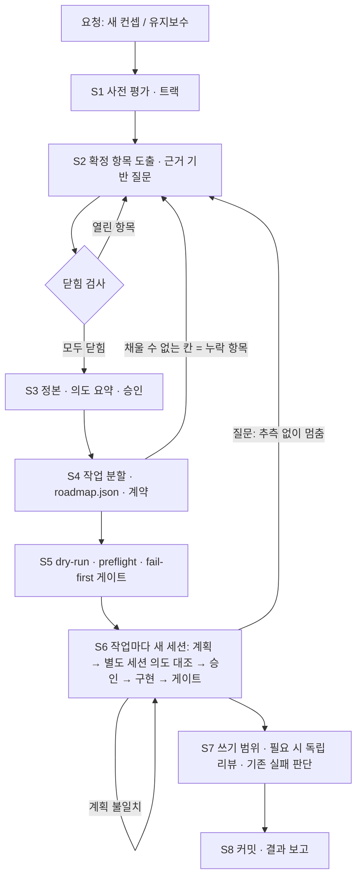

# 요청부터 반영까지

이 흐름의 목적은 두 가지다. **작업 전에 의도를 고정**하는 것, 그리고 **고정된 의도를 작은 작업으로 옮겨 작업마다 새 세션에 맡기는 것**이다. 한 에이전트를 목표 달성까지 계속 돌리는 흐름이 아니다.

## 용어

| 용어 | 뜻 |
| --- | --- |
| 조율 세션 | 사용자가 연 CLI 세션(Claude Code 또는 Codex)과 플러그인 스킬. 확정 도출·정본·분할·실행 요청을 맡는다. 제품 코드는 고치지 않는다 |
| 작업 세션 | 실행 층이 작업마다 새로 띄우는 실제 CLI 세션. 이전 대화를 모른다([task-sessions](task-sessions.md#execution)) |
| 실행 층 | 이 레포의 unit loop와 `step2step`. 작업마다 세션을 만들고, 게이트로 판정하고, 커밋한다([구성](plugin-architecture.md)) |
| 확정 목록 | 사용자 확정이 필요한 항목과 그 답의 목록([clarification](clarification.md#ledger)) |
| 의도 요약 | "무엇을 만들고, 무엇을 만들지 않으며, 무엇으로 완료를 판단하는가"를 한 화면 분량으로 적은 문서 |

## 단계

| 단계 | 누가 | 산출물 | 넘어가는 조건 |
| --- | --- | --- | --- |
| S1 사전 평가 | 조율 세션 (RTE-011) | 트랙, 읽은 자료, 미확인 영역, 리뷰 필요성 | 트랙과 근거 기록 |
| S2 확정 항목 도출 | 조율 세션 + 사용자 | 확정 목록 | [닫힘 조건](clarification.md#closure) 충족 |
| S3 정본·승인 | 조율 세션 (RTE-012·015) + 사용자 | 트랙별 정본, 의도 요약 | 사용자가 해당 revision을 승인 |
| S4 작업 분할 | 조율 세션 (RTE-012) | `roadmap.json`, `tasks/*.md`, `run.json` | 모든 계약의 필수 칸을 정본만으로 채움 |
| S5 실행 준비 | 실행 층 (`--dry-run`) | preflight, 프롬프트 미리보기, fail-first 게이트 결과 | 설정 오류 0, 모든 게이트가 작업 전 실패 |
| S6 작업 실행 | 실행 층, 작업마다 새 세션 | 계획, 의도 대조 결과, 코드 변경 | 게이트 통과 또는 blocked |
| S7 결과 확인 | 실행 층 + 리뷰 세션 (RTE-014) + 사용자(기존 실패) | 쓰기 범위 검사, 리뷰 결과 | 필수 지적 해결 |
| S8 반영·보고 | 실행 층 커밋, 조율 세션 보고 | 커밋·PR, 요청 단위 보고 | 프로젝트 Git 정책 충족([delivery](../app-plan/specs/repositories.md#delivery)) |

단계 사이의 상태는 모두 파일에 있다. 그래서 조율 세션도 단계 경계에서 새 세션으로 이어 갈 수 있다. 긴 확정 대화가 끝난 뒤 분할(S4)을 새 조율 세션에서 시작해도 된다. 이때 분할이 대화가 아니라 정본만을 근거로 하는지도 함께 확인된다.

## 트랙

사전 평가의 검토 범위([workflow 명세](../app-plan/specs/workflow.md#assessment))를 그대로 트랙으로 쓴다. 한 줄 수정에 세 묶음 승인을 요구하지 않기 위해서다.

| 트랙 | 확정 도출 | 정본·승인 | 작업 분할 | 독립 리뷰 |
| --- | --- | --- | --- | --- |
| 국소 | 요청 범위의 항목만. 영향이 고립됐는지 확인 | 기존 승인 재사용, 의도 요약만 승인 | 보통 작업 1개 | 위험 작업만 |
| 확장 | 관련 모듈·데이터 흐름·API 소비자까지 | 영향받는 문서만 새 revision으로 승인 | 여러 작업, 의존 순서 | 위험 작업만 |
| 전체 | 전체 차원 체크리스트 + 유사 서비스 조사 | 세 묶음 승인(요구 → 기능+와이어프레임 → 스택+상세 디자인, D-010) | 기능 단위 작은 작업 반복 | 위험 작업만 |

트랙은 파일 수가 아니라 영향 근거로 정한다(D-034). 진행 중 새 위험이 드러나면 트랙을 올린다. 트랙별 승인 범위는 [OD-4](open-decisions.md#od-4)에서 정한다.

## 사용자가 개입하는 지점

- **S2:** 질문에 답한다. 모든 질문은 맥락·선택지·추천을 갖춘다([질문 형식](clarification.md#questions)).
- **S3:** 의도 요약과 정본 revision을 승인한다.
- **S6:** 작업 세션이 질문을 내면 실행이 멈춘다. 그 항목에 답한다.
- **S7:** 요청과 무관한 기존 테스트 실패가 나오면 분리할지 범위를 넓힐지 정한다(Q-005).

작은 작업마다 따로 승인받지 않는다. 계획이 의도 대조를 통과하면 실행한다.

## 멈추는 경우

작업 세션이 질문을 내거나 막히면 실행 층은 그 작업을 `blocked`로 두고 멈춘다(`on_unit_blocked: halt`, [OD-9](open-decisions.md#od-9)). 그러면 흐름은 조율 세션과 사용자에게 돌아온다. 같은 증거로 같은 시도를 반복하지 않는다. 실패 대응은 기존 unit loop 정책과 [실패 계약](../app-plan/specs/orchestration.md#failure)을 따른다.
