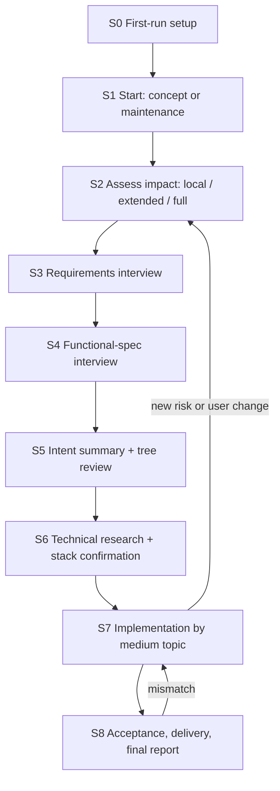

# Workflow

This document covers:
- the stages of a run
- how deep each stage goes for a given request
- when Barrel asks the human
- how changes to earlier decisions are handled

Interviews are detailed in [interviews.md](interviews.md), leaf execution in [task-execution.md](task-execution.md), and run start and delivery in [runs.md](runs.md).

## Stages

| Stage | Who | What happens | Output | Moves on when |
| --- | --- | --- | --- | --- |
| S0 First-run setup | Invoking session, with the user in the CLI | Finds the engines and the accounts, and asks whether the user has more subscriptions to add. Installs plugins, sets up the Slack app, creates Barrel.app, installs and starts the launcher (flow 1, Q05, Q09, Q11; Barrel.app is the AI's answer to Q10-2's request to make the page reopenable; details in [plugin.md](plugin.md#setup)) | `~/.barrel/settings.json`, Keychain entries | Every check passes. Runs only when something is missing |
| S1 Start | Invoking session | Takes the start input: a product concept, or a project to maintain plus what to change (flow 2). Prepares the folder, checks the project's run state, then asks the launcher to start the run ([runs.md](runs.md#start)) | A registered run, its branch, a Slack channel, an open PC view, an orchestrator | The orchestrator is running. The invoking session reports and ends (Q03-3) |
| S2 Assess | Orchestrator | Does three things: • On a project with no memory units yet, records what exists first ([onboarding](#onboarding)) • Asks in Slack whether to include an earlier run that is not merged, if there is one ([runs.md](runs.md#start)) • Reads the request against memory and code and classifies the impact (Q13) | A `decision` unit with the impact level and its reasons | Always |
| S3 Requirements | Orchestrator + user over Slack | Requirements interview (flow 3) | `requirement`, `answer` and `decision` units | See [interviews.md](interviews.md#exits) |
| S4 Functional spec | Orchestrator + user over Slack | Functional-spec interview built on the requirements (flow 4) | `feature` units | See [interviews.md](interviews.md#exits) |
| S5 Intent review | Orchestrator, then the user | Splits the work into large and medium topics and writes an intent summary. The user reviews them, as deep as the impact level asks (Q01, Q06, Q13) | Task nodes for the top two levels; the review document as a review record, with the specs attached ([interviews.md](interviews.md#review)) | The user approves the current revision in the review thread |
| S6 Implementation prep | Orchestrator, research and verification subagents, user | Technical research: how to implement each requirement, and which open-source projects or services to use, with pros, cons and constraints such as licensing, all from current sources. Then, when new technology enters, the user confirms the stack, the delegated scope and the tools (flow 6–8; Q13; archived D-013, Q-008) | `research` and `decision` units, a review record; `env` and `task_runner` in `.barrel/config.json` | The user approves the stack, when a confirmation was needed |
| S7 Implementation | Orchestrator, task sessions | Preflight and baseline first ([task-execution.md](task-execution.md#preflight)). Then medium topics run in tree order. Each one is split into leaves when its turn comes, and the leaves run in fresh sessions. While one topic is blocked, independent work continues ([task-tree.md](task-tree.md#split)). Each finished topic gets a regression check (flow 9–10, Q01, Q06, Q14) | Commits on the run branch, task status | Every leaf is done or abandoned with a reason |
| S8 Acceptance | Orchestrator, review subagents | Every gate runs. Then the AI judges whether the result matches the requirements and the functional spec (Q01). Mismatches become new leaves. Then the result is delivered and the final report is posted ([task-execution.md](task-execution.md#acceptance), [runs.md](runs.md#delivery)) | The acceptance record, the delivery, the final report | The result matches and is delivered as `git.delivery` says. The run ends with a mention to the user (Q10 default; archived D-024) |

The stages follow the original flow:
- Requirements first, then the functional spec (flow 3–4).
- The intent review comes after the functional spec and before implementation (Q01, Q06).
- Implementation prep starts with technical research (flow 6–7) and ends with the stack confirmation (flow 8), when new technology enters (Q13).

## Onboarding an existing repo

The first run on a project with no memory units yet starts S2 by recording what already exists. (The launcher has already written a default `config.json` by then, so the test is the memory, not the folder.) Without this, Barrel has no stack decisions to compare a request against, and every dependency the code already uses would count as new technology ([depth](#depth)).

Context-gathering subagents survey the repo, and the orchestrator records what they found (archived workflow.md#assessment, D-026, D-034; details AI):
- **The product, as far as the code shows it:** an `intent` unit, marked inferred. The user confirms it with the S5 intent summary.
- **The existing stack, conventions, and build and test commands:** `decision` units with the source `existing code`. The commands also go into `task_runner.preflight`, `task_runner.baseline` and `env.setup` ([sessions.md](sessions.md#engines)).
- **Behavior that must not change, and invariants:** `constraint` units.
- **What could not be verified**, such as a missing test environment, recorded as such.

## Depth by impact

In S2 the orchestrator investigates first and only then sets the depth of the later stages (Q13).

Impact is judged on four things, never on file or line counts (archived D-026, D-034, Q13):
- gaps in the intent
- actions that are hard to undo
- the footprint of the change: modules, data flows, API consumers
- critical paths

| Stage | Local | Extended | Full |
| --- | --- | --- | --- |
| S3 Requirements | Only questions the documents cannot answer; the affected requirements are updated | Interview the affected requirements only | Full interview |
| S4 Functional spec | The affected features are updated | Interview the affected features only | Full interview |
| S5 Intent review | One short intent summary | Intent summary plus the affected topics | Intent summary plus the large and medium topics |
| S6 Implementation prep | Only if new technology enters | Only if new technology enters | Full technical research. Stack confirmation when new technology enters, which a new concept always does |
| S7, S8 | Always | Always | Always |

Rules (all Q13):
- A new product concept is always **full**.
- The stack is confirmed only when new technology enters, at every depth. A full-impact change that adds no technology still gets full research, but no stack confirmation.
- The intent review before implementation is never skipped, whatever the depth (Q01).
- When new risk appears mid-run, the orchestrator raises the impact level and runs the stages that are now needed.
- "New technology" means a dependency, service, framework or tool that no stack decision covers, including those recorded at [onboarding](#onboarding) (AI).

## When Barrel asks the human

Barrel asks a question in two cases only (Q01, Q06):
- The planning intent, the requirements and the functional spec cannot settle the direction.
- A genuinely new decision is needed.

Separately, it requests things only the user can do: logging in, credentials, payment, granting a permission. Such a request blocks only the work that needs it (Q01, option 1-a A; flow 10).

Barrel does not ask about:
- **Test failures, build errors and environment problems.** It retries and replans (Q01, option 1-a A; details in [task-execution.md](task-execution.md#failures)).
- **Usage limits.** It moves to the next account or CLI (Q05, Q12). Only when nothing is usable does it wait for the reset and resume on its own (Q01, option 1-a A).
- **Anything inside the scope the user delegated in S6** (archived D-013).

Before a question is posted:
- A hard question gets advice from an advice subagent on the frontier tier (flow 0, Q02, Q16).
- The question is researched, and the findings are verified (flow 5, Q16).

See [interviews.md](interviews.md) for both steps.

**Flow 10.** When implementation or testing needs something from the user, Barrel asks only for what only the user can provide. It then finishes the setup itself with tools such as browser automation or computer use. Example: it asks the user to sign in to AWS, then creates the needed IAM keys and configures the CLI (flow 10).
- How this works is in [task-execution.md](task-execution.md#user-only).
- Where secrets are entered is an AI default awaiting review ([open-decisions.md](open-decisions.md#ai-defaults)).

## Blocked work

- A task that waits for a human answer is the only thing that stops. Unrelated tasks keep running (Q01).
- A task that depends on a blocked task waits as well.
- The question is posted to Slack and reminded on a fixed schedule ([slack.md](slack.md#questions)).

## When the user changes an earlier decision

When an instruction or an answer changes something decided earlier, the decisions that conflict with it are decided together (Q01):

1. The launcher records the new answer as an `answer` unit ([interviews.md](interviews.md#recording)).
2. The orchestrator follows the backlinks of the affected units to find the other units and task nodes that conflict with the change ([memory.md](memory.md#index)) (AI).
3. It asks the user about each cascading change, with the context needed to decide it: what was decided, what the change breaks, and the options (Q01).
4. If leaves that the change affects are running, the same question asks which way to go (archived D-031):
   - stop them now and apply the change
   - let them finish and fix the result afterwards

   Stopping one uses `barrel task cancel`, an orchestrator command. It is not a user-facing stop for a single task (Q10-2).
5. It updates or supersedes the affected units and re-plans the task nodes that are not done yet. Finished work that must change becomes new leaves (AI).

## Where the user is involved

| When | Where | What the user does |
| --- | --- | --- |
| S0, S1 | The CLI session where the skill was run | Answers setup prompts and gives the start input |
| S3, S4 | Slack question threads | Answers interview questions |
| S5 | A Slack review thread | Approves the intent summary and the tree, or asks for changes |
| S6 | A Slack review thread | Confirms the stack, the delegated scope and the tools |
| S7 | Slack question threads | Answers questions that block a task |
| S7 | Slack request threads, or the Mac | Does things only the user can do: gives a credential in the thread or with `barrel secret set` on the Mac, or signs in in the automation browser on the Mac ([task-execution.md](task-execution.md#user-only)) |
| S8 | Slack | Reads the final report (with a mention) |
| Any time | Slack channel | Asks for status, stops, resumes, opens the view, changes the language, sends instructions ([slack.md](slack.md#commands)) |
| Any time | The PC view | Watches progress, stops, resumes ([pc-view.md](pc-view.md)) |

Stop and resume work at any stage and halt the whole run ([launcher.md](launcher.md#stop)).
