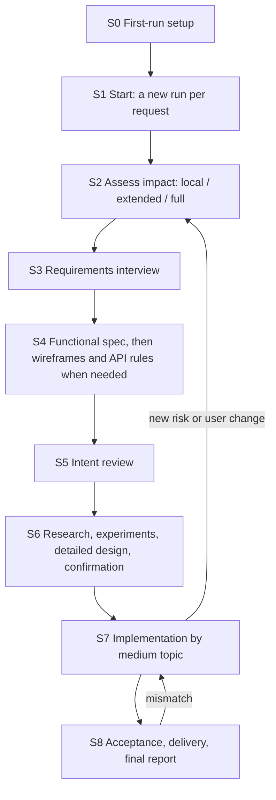

# Workflow

This document covers:
- the stages of a run
- wireframes, API rules, detailed design and experiments
- how deep each stage goes for a given request, and what counts as new technology
- when Barrel asks the human
- how changes to earlier decisions are handled, including edits the user makes directly

Interviews are detailed in [interviews.md](interviews.md), leaf execution in [task-execution.md](task-execution.md), and projects, runs and delivery in [runs.md](runs.md).

## Stages

| Stage | Who | What happens | Output | Moves on when |
| --- | --- | --- | --- | --- |
| S0 First-run setup | Invoking session, with the user in the CLI | Details in [plugin.md](plugin.md#setup): • finds the engines and the accounts, and asks whether the user has more subscriptions to add (flow 1, Q05) • records a short user profile, including whether the user is a developer (archived D-001, Q-001; Q17) • offers to connect GitHub, which the user may skip (archived Q-002) • lists the user's personal CLI settings and takes only the ones the user picks (archived D-048; Q17-2) • creates the Barrel-managed config folders, installs plugins, sets up the Slack app, creates Barrel.app and starts the launcher (Q09, Q11; Barrel.app is the AI's answer to Q10-2) | `~/.barrel/settings.json`, `~/.barrel/accounts/`, Keychain entries | Every check passes. Runs only when something is missing |
| S1 Start | Invoking session, then the launcher | The skill takes the start input: a product concept, or a project to maintain plus what to change (flow 2). It finds or prepares the project's planning repo ([runs.md](runs.md#projects)). Then it asks the launcher to start a new run, even while another run of the project is going on (Q18). The launcher's first step clones the repos missing from the parent folder. A clone that needs a login becomes a request in Slack (Q17-2, Q03-3; [runs.md](runs.md#start)) | A registered run with its request name and branches, a Slack channel, an open PC view, an orchestrator | The orchestrator is running. The invoking session reports and ends (Q03-3) |
| S2 Assess | Orchestrator | Does four things: • On a project with no memory units yet, records what exists first ([onboarding](#onboarding)) • Settles where the run starts from, when that is unclear ([runs.md](runs.md#start-state)) • Reviews edits the user made directly in `.barrel/` ([direct edits](#edits)) • Reads the request against memory and code and classifies the impact (Q13) | A `decision` unit with the impact level and its reasons | Always |
| S3 Requirements | Orchestrator + user over Slack | Requirements interview (flow 3) | `requirement`, `answer` and `decision` units | See [interviews.md](interviews.md#exits) |
| S4 Functional spec | Orchestrator + user over Slack; designer sessions | Functional-spec interview built on the requirements (flow 4). Then, for a project with screens, wireframes made from the functional spec. For a project with an API, the API's rules follow the wireframes ([design](#design)) | `feature` units; `screen` units with wireframes; `api` units | See [interviews.md](interviews.md#exits) |
| S5 Intent review | Orchestrator, then the user | Splits the work into large and medium topics and writes an intent summary. The user reviews them together with the specs, the wireframes and the API rules, as deep as the impact level asks (Q01, Q06, Q13; archived Q-011) | Task nodes for the top two levels; the review document as a review record ([interviews.md](interviews.md#review)) | The user presses [승인 rN] on the current revision (archived D-045; Q17) |
| S6 Implementation prep | Orchestrator; research and verification subagents; designer and experiment sessions; the user | Technical research: how to implement each requirement, and which open-source projects or services to use, with their pros, cons and constraints such as licensing, all from current sources (flow 6–7). For a project with screens it covers modern UI references (archived Q-010, Q-019). Minimal [experiments](#experiments) where a choice needs one. Then the detailed design of the main screens. The user then confirms what needs confirming (flow 8; Q13, Q19; archived D-013, Q-008, Q-011; Q17-2): • the hard-to-reverse choices • the detailed design • the delegated scope and the tools • any change to the repo list | `research` and `decision` units, a review record; `env` and `task_runner` in `.barrel/config.json` | The user approves the current revision, when a confirmation was needed ([interviews.md](interviews.md#exits)) |
| S7 Implementation | Orchestrator, task sessions | Preflight and baseline first ([task-execution.md](task-execution.md#preflight)). Then medium topics run in tree order (flow 9–10, Q01, Q06, Q14, Q24): • Each one is split into leaves when its turn comes, and the leaves run in fresh sessions. • Every session updates memory before it ends. • While one topic is blocked, independent work continues ([task-tree.md](task-tree.md#split)). • Each finished topic gets a regression check and a memory consolidation | Commits on the run branches, task status, memory updates | Every leaf is done or abandoned. Abandoning one that would drop a requirement needs the user's answer ([task-execution.md](task-execution.md#failures)) |
| S8 Acceptance | Orchestrator, review subagents | Every gate runs. Then the AI judges whether the result matches the requirements and the functional spec (Q01). Mismatches become new leaves. Then the result is delivered to every repo of the project, and the final report is posted ([task-execution.md](task-execution.md#acceptance), [runs.md](runs.md#delivery)) | The acceptance record, the delivery, the final report | The result matches and is delivered as `git.delivery` says, in every repo the run changed. The run ends with a mention to the user (Q10 default; archived D-024) |

**What "done" means** (archived D-003; Q17):
- Barrel builds general software: web, desktop, mobile, automation.
- It finishes a project as far as the project needs: installation, deployment, tests and verification in real use.
- Generated code alone is not completion.
- The acceptance check uses the verification the specs call for ([task-execution.md](task-execution.md#acceptance)).

The stages follow the original flow:
- Requirements first, then the functional spec (flow 3–4).
- Wireframes follow the functional spec, before any UI design (archived Q-010).
- The intent review comes after the functional spec and before implementation (Q01, Q06).
- Implementation prep starts with technical research (flow 6–7) and ends with the stack confirmation (flow 8), when a hard-to-reverse choice is needed (Q13, Q19).

## Onboarding an existing project

The first run on a project with no memory units yet starts S2 by recording what already exists. (The launcher has already written a default `config.json` by then, so the test is the memory, not the folder.) Without this, Barrel has no stack decisions to compare a request against, and every dependency the code already uses would count as new technology ([depth](#depth)).

Context-gathering subagents survey every repo of the project, and the orchestrator records what they found (archived workflow.md#assessment, D-026, D-034; details AI):
- **The product, as far as the code shows it:** an `intent` unit, marked inferred. The user confirms it with the S5 intent summary.
- **The existing stack, conventions, and build and test commands:** `decision` units with the source `existing code`. The commands also go into `task_runner.preflight`, `task_runner.baseline` and `env.setup` ([sessions.md](sessions.md#engines)).
- **The project's own instructions for agents**, such as a `CLAUDE.md` or an `AGENTS.md` in a repo: `constraint` and `decision` units (archived D-048: project instructions are part of the assessment).
  - An engine reads only its own file, so a rule kept only there would reach one engine and not the other.
  - Recorded as units, it reaches every session through memory (flow 1; AI).
- **What already exists in code:** `implementation` units for the main modules and interfaces, so later sessions can find them ([memory.md](memory.md#kinds)) (AI).
- **Behavior that must not change, and invariants:** `constraint` units.
- **What could not be verified**, such as a missing test environment, recorded as such.

## Wireframes, API rules and detailed design

All of this comes from the archived decisions Q-010, Q-011, Q-019 and P-002, which Q17 restored. Details are AI where tagged.

- **When.** Only for a project with screens (wireframes, detailed design) or with an API (API rules). A project without them, or a small change to an existing screen, does without: it follows the existing design (archived Q-010, Q-011).
- **Order.** The user's own words were: "요구사항명세서 -> 기능명세서 -> 와이어프레임 -> API 작업 및 디자인 구체화" (archived Q-010):
  1. Requirements (S3).
  2. Functional spec (S4).
  3. Wireframes, made from the functional spec (S4).
  4. API rules, for a project with an API (S4).
  5. The S5 intent review.
  6. Research, including modern UI references (S6).
  7. The detailed design of the main screens (S6).
  8. The S6 confirmation.
  9. Implementation in small units (S7).
- **Wireframes.**
  - They show the screens and the flow between them, before any UI design.
  - So the design can build on them instead of being redone (archived Q-010).
  - A `designer` session draws them from the functional spec ([sessions.md](sessions.md#roles)).
  - Each screen gets a `screen` unit linked to the features it serves ([memory.md](memory.md#kinds)).
- **API rules.**
  - After the wireframes, the orchestrator settles each API's inputs, outputs, permissions and error rules (archived Q-011).
  - The specification itself belongs to the code repo that serves the API (archived Q-015).
  - An `api` unit in the planning repo points to it, with its revision.
- **Detailed design.**
  - In S6, after the research into modern references, a designer session turns the wireframes into the detailed design of the main screens.
  - It applies the references' techniques, such as images in backgrounds and content, so the result does not look like generic AI output, which the user called "AI Slop" (archived Q-010, Q-019).
  - Collecting references without applying them does not count (archived Q-019).
- **Images.**
  - Any image generation service will do; none is required or preferred (archived Q-019).
  - Codex has built-in image generation within its plan's limits, with no API key ([research.md](research.md#vendors)).
  - Other services are used through browser automation with the user's own sign-ins ([task-execution.md](task-execution.md#user-only)).
  - The choice follows availability, not the provider (Q16; AI).
- **Format and tools** are implementation choices (archived P-002; AI).
  - Every revision the user reviews is stored in `.barrel/design/<run>/r<N>/`, so the approval covers exactly those files ([memory.md](memory.md#layout)).
  - Design files and specs live in git with the code (archived Q-013).
- **Reviews.**
  - The wireframes and the API rules go into the S5 intent review. The detailed design goes into the S6 confirmation (archived D-010, Q-011; Q17).
  - Neither gets an approval of its own (archived Q-011).
- **During implementation**, UI leaves are reviewed against the approved design ([task-execution.md](task-execution.md#review)).

## Experiments before approval

From archived D-042, which Q17 restored. Details AI.

- **What.** In S6, Barrel may run the minimal experiments that a technical choice needs before the user confirms it, for example a short trial of a library or a service.
- **Where.**
  - An experiment runs in an `experiment` session, in a folder of the run state ([memory.md](memory.md#run-state)).
  - It never runs in the user's repos or live environments.
  - It stays within the cost and permission scope that is already approved.
- **Record.** Each experiment records its purpose, its success condition, its scope and the resources it used. The result goes into a `research` unit and into the S6 confirmation.
- **No shortcut.** Experiment code is never merged. Turning what it showed into product code goes through the normal approvals and leaves.

## Depth by impact

In S2 the orchestrator investigates first and only then sets the depth of the later stages (Q13).

Impact is judged on four things, never on file or line counts (archived D-026, D-034, Q13):
- gaps in the intent
- actions that are hard to undo
- the footprint of the change: modules, data flows, API consumers, other repos of the project
- critical paths

| Stage | Local | Extended | Full |
| --- | --- | --- | --- |
| S3 Requirements | Only questions the documents cannot answer; the affected requirements are updated | Interview the affected requirements only | Full interview |
| S4 Functional spec | The affected features are updated. Wireframes only for a new screen or a changed flow | Interview the affected features; wireframes and API rules for the affected screens and APIs | Full interview, wireframes, API rules |
| S5 Intent review | One short intent summary | Intent summary plus the affected topics | Intent summary plus the large and medium topics |
| S6 Implementation prep | Only if new technology enters or a main screen's design changes | Same as local | Full technical research. A confirmation when new technology enters or screens are designed, which a new concept with screens always has |
| S7, S8 | Always | Always | Always |

Rules:
- A new product concept is always **full** (Q13).
- The stack is confirmed only when new technology enters, at every depth (Q13). A full-impact change that adds no technology still gets full research, but no stack confirmation.
- The intent review before implementation is never skipped, whatever the depth (Q01).
- When new risk appears mid-run, the orchestrator raises the impact level and runs the stages that are now needed ([going back](#back)).

**What counts as new technology** (Q19; it replaces the AI's earlier definition, "any dependency no decision covers").

The user confirms the choices that are hard to reverse:
- languages and runtimes
- frameworks
- databases and storage
- external services and APIs, such as authentication, payment and hosting
- anything that costs money
- licenses that restrict use, such as copyleft (GPL, AGPL) or commercial ones (PyQt)
- tools installed on the PC

Everything else follows three rules:
- **Barrel chooses** ordinary libraries within the confirmed stack. Each choice is recorded as a `decision` unit with its reason and listed in the final report (Q19).
- **Checked, not asked.** Every new package must exist, be maintained, and have an acceptable license and no known vulnerability ([task-execution.md](task-execution.md#packages)) (Q19). A library that brings a restricted license or a cost moves into the confirmed group (Q19).
- **Already confirmed** are the stack and dependencies recorded at [onboarding](#onboarding). New ordinary libraries within them are not asked (Q19 analysis; AI).

Two more points:
- A chosen library that does not work out is swapped within the confirmed stack, and the reason is recorded (archived D-041).
- A non-developer gets these questions in plain words, with a recommendation (Q19; [interviews.md](interviews.md#format)).

## When Barrel asks the human

Barrel asks a question in two cases only (Q01, Q06):
- The planning intent, the requirements and the functional spec cannot settle the direction.
- A genuinely new decision is needed.

Separately, it requests things only the user can do: logging in, credentials, payment, granting a permission, saving the sudo password. Such a request blocks only the work that needs it (Q01, option 1-a A; flow 10; Q20).

Barrel does not ask about:
- **Test failures, build errors and environment problems.** It retries and replans (Q01, option 1-a A; details in [task-execution.md](task-execution.md#failures)).
- **Usage limits.** It moves to the next account or CLI (Q05, Q12). Only when nothing is usable does it wait for the reset and resume on its own (Q01, option 1-a A).
- **Anything inside the scope the user delegated in S6** (archived D-013).
- **Ordinary libraries** within the confirmed stack ([new technology](#new-technology)) (Q19).

Some changes are always asked:
- **The repo list.** Adding or removing a repo is a structural decision. It is confirmed in S5 or S6 (Q17-2).
- **Dropping a requirement.** The user decides it, never the AI (Q01; archived D-041; [task-execution.md](task-execution.md#failures)).

Before a question is posted:
- A hard question gets advice from an advice subagent on the frontier tier (flow 0, Q02, Q16).
- The question is researched, and the findings are verified (flow 5, Q16).

See [interviews.md](interviews.md) for both steps.

**Flow 10.** When implementation or testing needs something from the user, Barrel asks only for what only the user can provide. Then it finishes the setup itself with tools such as browser automation or computer use. Example: it asks the user to sign in to AWS, then creates the needed IAM keys and configures the CLI (flow 10).
- **Credentials** come through a native macOS dialog on the Mac, never through Slack (Q20).
- **Commands that need administrator rights** go through Barrel's sudo tool, which uses a password the user saves once (Q20).

How this works is in [task-execution.md](task-execution.md#user-only).

## Blocked work

- A task that waits for a human answer is the only thing that stops. Unrelated tasks keep running (Q01).
- A task that depends on a blocked task waits as well.
- The question is posted to Slack and reminded on a fixed schedule ([slack.md](slack.md#questions)).

## When the user changes an earlier decision

When an instruction or an answer changes something decided earlier, the decisions that conflict with it are decided together (Q01):

1. The launcher records the instruction or the answer verbatim as an `answer` unit ([interviews.md](interviews.md#recording)).
2. The orchestrator follows the backlinks of the affected units to find the other units and task nodes that conflict with the change ([memory.md](memory.md#index)) (AI).
3. It asks the user about each cascading change, with the context needed to decide it: what was decided, what the change breaks, and the options (Q01).
4. If leaves that the change affects are running, the same question also asks when the change applies (archived D-031):
   - **From the next task.** Running leaves finish under the earlier decision. Finished work that must change becomes new leaves (step 5).
   - **Now.** The affected leaves stop, and the change applies at once. Stopping one uses `barrel task cancel`, an orchestrator command. It is not a user-facing stop for a single task (Q10-2).

   This choice also covers changes to permissions, costs and approval scope (archived D-031).
   - The project may set a default answer: `cascade.default` in `.barrel/config.json`, one of `ask`, `next_task` or `now`. The default is `ask` (archived D-031; Q17; key AI).
   - Like any setting in that file, it can be changed by editing it or by an instruction in Slack ([sessions.md](sessions.md#engines)).
5. It updates or supersedes the affected units and re-plans the task nodes that are not done yet. Finished work that must change becomes new leaves (AI).

Memory that changes while a session runs reaches that session only at its memory turn, when it ends. Every new session starts from the current memory (archived D-031: automatic updates apply from the next CLI session; Q24).

**Edits the user makes directly** (archived D-020; Q17; detection AI):
- **Anyone may edit `.barrel/`.** People may edit `.barrel/` files themselves, in their own checkout, like any file in the repo (Q12).
- **How Barrel finds them.**
  - Such edits reach a run through git: through the run's base at start, and through the base merge before delivery ([runs.md](runs.md#delivery)).
  - The launcher finds them as `.barrel/` changes in commits that carry no `Barrel-Run` trailer, and emits `user_edit`.
- **The review.** The orchestrator checks each edit for conflicts, contradictions and impact.
  - If a new judgment is needed, it asks.
  - Even when the existing plan seems to resolve it, it explains the context, the reasons and what it needs, and asks whether to apply that resolution.
  - It never applies a resolution silently (archived D-020).
- **Not reviewed:**
  - Edits to `.barrel/config.json` are ordinary team edits (Q12). They apply from the next session.
  - This review does not make every ordinary action ask again (archived D-020).

**Decisions that arrive through a merge** come from an earlier run, the base, or a parallel run of the same project (Q18). The orchestrator checks them against the run's own decisions, and a conflict is asked as a question with its cascade (Q18; AI).

**Going back from S7 to S2** (AI). Sometimes an instruction, an answer or a finding during S7 changes what earlier stages settled:
1. The leaves the change affects stop or finish, as step 4 above decides.
2. The orchestrator runs again the stages the change needs:
   - S2, the assessment
   - S3 and S4 for the affected requirements and features
   - the wireframes or the API rules if a screen or an API changes
   - S6 if a hard-to-reverse choice changes
3. If the change touches what the user reviewed in S5 or S6, a new revision of that review is posted and approved before the affected work resumes.
4. Unaffected leaves keep running (Q01).

## Where the user is involved

| When | Where | What the user does |
| --- | --- | --- |
| S0, S1 | The CLI session where the skill was run | Answers setup prompts and gives the start input |
| S1 | Slack | Logs in when cloning a repo needs it ([runs.md](runs.md#start)) |
| S2 | Slack question threads | When asked, says where the run starts from (developers), or whether there is a git policy to follow (non-developers) ([runs.md](runs.md#start-state)) |
| S3, S4 | Slack question threads | Answers interview questions |
| S5 | A Slack review thread | Presses [승인 rN] for the intent summary, the tree, the specs, the wireframes and the API rules, or asks for changes in the thread |
| S6 | A Slack review thread | Confirms the hard-to-reverse choices, the detailed design, the delegated scope, the tools, the Git delivery scope and any change to the repo list, by the same button |
| S7 | Slack question threads | Answers questions that block a task |
| S7 | Slack request threads, and the Mac | Does things only the user can do ([task-execution.md](task-execution.md#user-only)): • types a credential into the macOS dialog • saves the sudo password once • signs in in the automation browser • agrees to a time window for screen control |
| S8 | Slack | Reads the final report (with a mention). Merges a pull request when the delivery needs it |
| Any time | Slack channel | Asks for status, stops and resumes, cancels a run, opens the view, changes the language or the sleep policy, sends instructions ([slack.md](slack.md#commands)) |
| Any time | The PC view | Watches progress, stops, resumes ([pc-view.md](pc-view.md)) |

Stop and resume work at any stage and halt every run of the project. Cancelling ends one run ([launcher.md](launcher.md#stop)).
